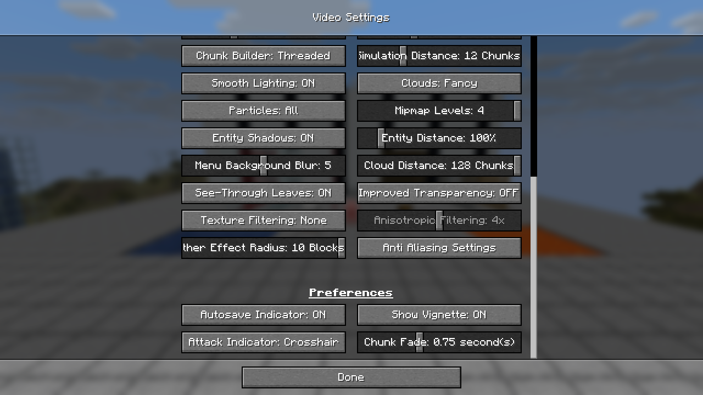
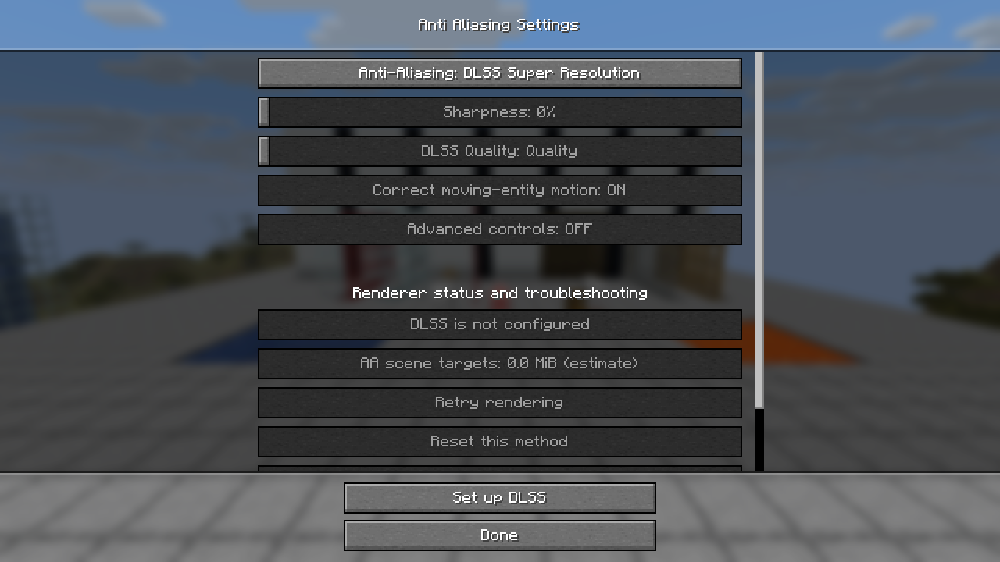

# DLSS menu refinement validation

Validated October 24, 2026 on Minecraft 26.3, Windows 11 x64 and an RTX 3060 Ti.
`gradlew build` passed all **124 tests**, including the public-JAR packaging guard.

The Video Settings entry now shares the Weather Effect Radius row, immediately before Preferences,
matching the marked screenshot. Its vanilla weather option binding remains intact.

DLSS selection is independent of native readiness. In-game checks confirmed that it can be selected
without runtime files and remains selected after a full restart. Until ready, tuning, advanced,
retry and reset controls are disabled. Clicks on disabled controls left their values unchanged.
Rendering uses a native scene while the selected method awaits setup or restart.

Only DLSS shows the setup action, fixed above Done so it remains accessible while scrolling.
It reads **Set up DLSS** initially and **Change DLSS setup...** after a runtime folder is connected.
After importing the production files and restarting, basic and advanced controls became usable.
Switching to FXAA hid the setup action and restored the normal footer.

The final public jar rendered real DLSS Quality at **853 × 480 → 1280 × 720**, with no recorded
native DLSS evaluation failures. It contains the mod bridge and zero NVIDIA runtime DLLs.
Testing used the isolated instance `run/dlss-menu-refinement`; no test configuration was written
to the normal `run/26.3` instance.

- Artifact: `salts-anti-aliasing-mc26.3-1.1.jar`, 3,313,785 bytes.
- SHA-256: `f3c8755055603e219784c47cd5c39c75fec98c6ed59689706b2cf8ece1eb6f49`.
- [Machine-readable checks](validation-dlss-menu/evidence.json).
- [Video Settings placement](validation-dlss-menu/video-button-position.png).
- [Unconfigured DLSS](validation-dlss-menu/unconfigured-dlss.png).
- [Ready DLSS](validation-dlss-menu/ready-dlss.png).

