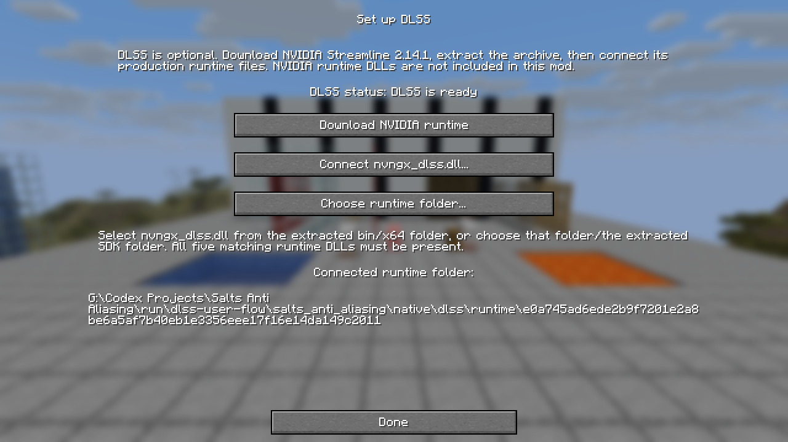
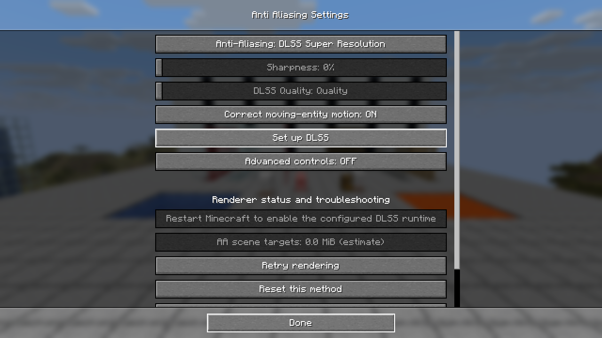
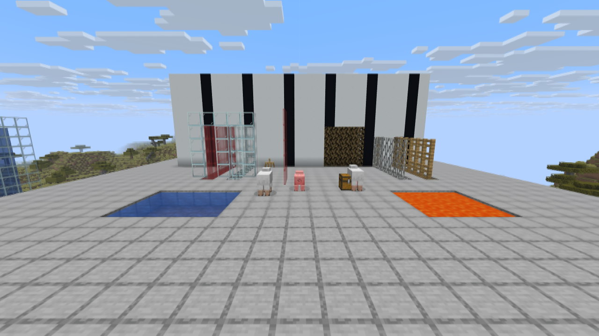

# User-downloaded DLSS runtime validation

The later [menu refinement validation](dlss-menu-refinement-validation.md) covers the current
conditional setup button and always-selectable DLSS method. The results below describe the initial
download-and-connect implementation.

Validated on October 24, 2026, using Minecraft 26.3, Fabric Loader 0.19.5, Fabric API
0.162.0+26.3, Java 25.0.2, Windows 11 x64, an RTX 3060 Ti and NVIDIA driver 591.86.
The supported runtime is the production Windows x64 set from Streamline 2.14.1.

## Build and packaging

`gradlew build` passed: **124 tests, zero failures, errors or skips**. Eight new import tests cover
runtime discovery, missing companions, invalid headers, wrong architecture, changed bytes,
private copying, notices, cache repair and rejection of executables. The existing three atomic
bridge-copy tests remain in place.

The normal build and a build with `-PdlssRuntimeDirectory=build/dlss-release-runtime` both passed
the public archive guard. That property now configures only the development JVM. The final jar
contains the matching mod bridge and **zero NVIDIA executable runtime DLLs**. Disposable QA
classes are also absent.

| Artifact | Value |
| --- | --- |
| Jar | `salts-anti-aliasing-mc26.3-1.1.jar` |
| Size | 3,311,471 bytes |
| SHA-256 | `0ca335f67f43654257d3f571e33e9b10429620c3ce8b6852ffe9d505aaf736e2` |
| Bridge SHA-256 | `2609dabf9ca826ab01f5610302621dcd0ef10ff264d2851a46913f061ee351a6` |

## Real game checks

The test used an isolated copy of the audit world under `run/dlss-user-flow`. The user's normal
`run/26.3` configuration was verified byte-for-byte unchanged.

- Setup was reachable with AA Off, advanced controls Off and no configured DLSS runtime.
- Download opened the official Streamline 2.14.1 release page in the system browser.
- The real Windows file dialog opened; cancellation preserved the configuration.
- The real Windows folder dialog rejected an incomplete set and named the four missing files.
- Selecting the production `nvngx_dlss.dll` copied all five validated DLLs and available notices
  into the private instance directory. Selecting the extracted SDK root also worked.
- After a full restart through Gradle `runClient`, DLSS reported ready and rendered Quality at
  **853 × 480 → 1280 × 720**. The developer override also rendered successfully with the saved
  plugin path blank.
- The final public jar was launched without development source directories and rendered the same
  DLSS Quality output from the imported files. No native DLSS evaluation failures were recorded.
- A subsequent import required a restart. Reconfiguring settings and retrying rendering preserved
  that requirement. Both the setup screen and main AA status displayed the reason.
- Imported license notices were readable and scrollable. Windows line endings rendered normally.

## Test notes

Testing found and fixed a zero-height scroll container, corrupted ellipsis labels, a restart
requirement that could be cleared by repeated configuration, stale rendering status after import,
and visible carriage-return glyphs in license text. The final public-jar checks include those fixes.

One early instrumented launch inherited a stale stop request and shut down during startup shader
compilation; the NVIDIA driver crashed during that premature shutdown. The request was cleared,
and subsequent complete launches and shutdowns passed. This aborted instrumentation run is excluded
from the successful rendering results.

This follow-up validates setup, loading and packaging on the tested Windows system. The earlier
AA image-quality audit remains separate. Fullscreen and other GPU/driver combinations were not
exhaustively retested for this setup change.

[Machine-readable evidence](validation-dlss-user-runtime/evidence.json) records the four successful
rendering captures and manual checks. Raw launch logs, test output and screenshots remain in
`build/dlss-user-flow` and `run/dlss-user-flow`.
