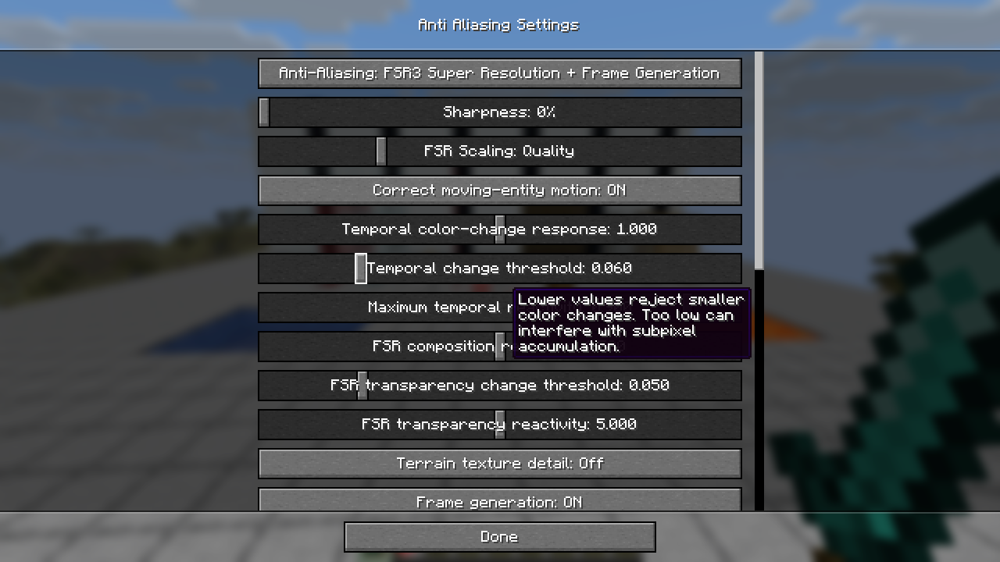
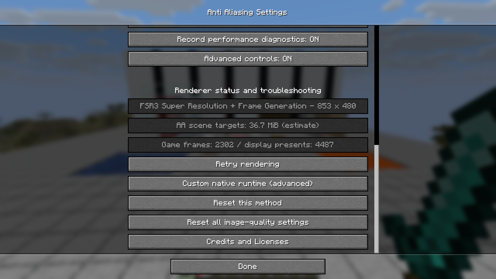
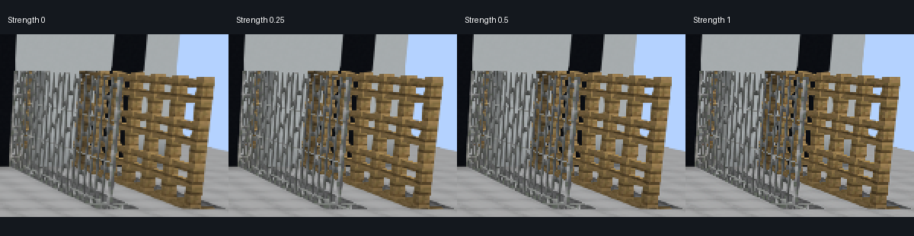
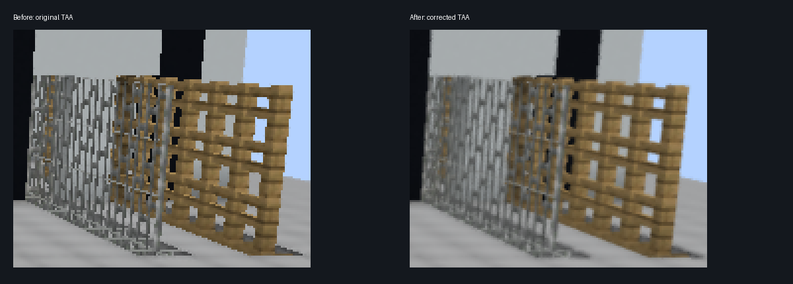
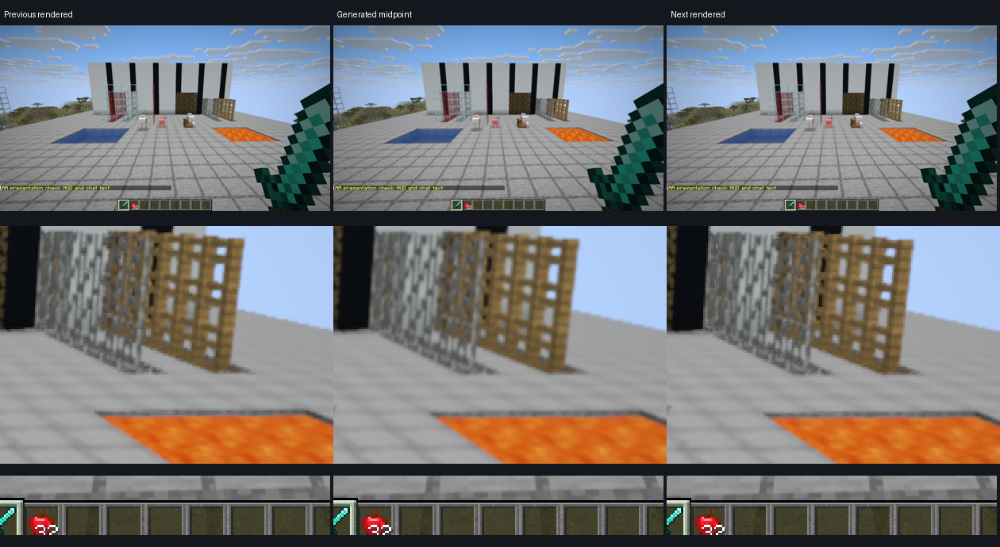
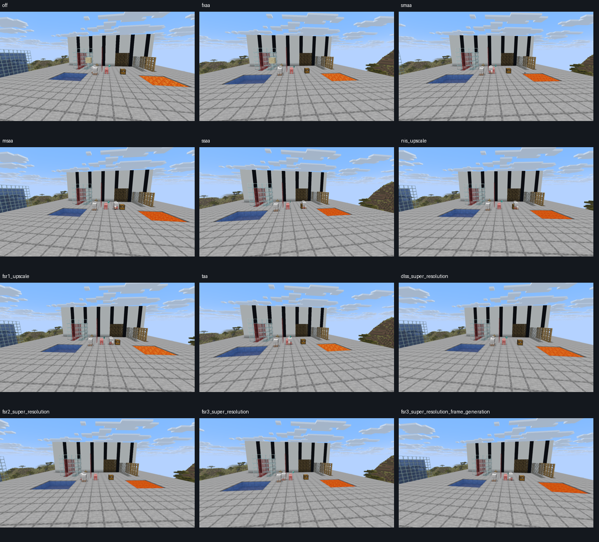

# Fabric 26.3 audit implementation and validation

Implementation date: 24 October 2026. Baseline: `a3025cb` on `fabric-26.3`.
This document accompanies the original [audit PDF](../output/pdf/salts-anti-aliasing-fabric-26.3-audit.pdf).
It records implemented fixes and the limits of the follow-up evidence, rather than promising
artifact-free output on every scene or device.

## Settings and configuration

**Options → Video Settings → Anti Aliasing Settings** opens the complete mod menu. Mod Menu and
Sodium link to that screen too. The original inline controls have been removed from Video Settings.
Basic controls follow the chosen method; Advanced controls reveals additional relevant parameters,
diagnostics and custom native-runtime paths. Input AA and MIP-bias choices rebuild their dependent
controls while preserving scroll position and the Advanced state.

Sliders preview live and save when leaving the screen. Method and global resets preserve explicit
native paths. Configuration version 3 migrates existing settings, bounds invalid tuning, deep-copies
snapshots and preserves explicit v2 sharpening, including a saved 25% value. Resets preserve exact
algorithm defaults even where those values fall between UI slider increments.





## Changes by method

| Method | Implemented change | Remaining tradeoff |
| --- | --- | --- |
| Off | Releases inactive scene targets; zero sharpening remains the comparison default. Effective status and target-payload estimate are visible. | Positive independent sharpening intentionally still runs. The estimate excludes SDK, temporary post-chain and driver allocations. |
| FXAA | Exposes subpixel blend, edge threshold and minimum contrast; default subpixel blend is 0.5. Retains the contrast early exit and bounded quality search. | Spatial filtering softens texture detail and does not accumulate subpixel geometry over time. |
| MSAA | Keeps the working coverage/depth path; exposes sample count and optional alpha-to-coverage in the dedicated menu. Adds GPU resolve timing and cleanup/recovery integration. | Cutout alpha-to-coverage can stipple/fade distant leaves. Interior texture aliasing remains. |
| SSAA | Defaults to sRGB decode → linear-light area integration → sRGB encode. Adds integrated tent filtering and legacy encoded-light choice, preserving fractional coverage. Releases inactive large targets and reports unsupported target sizes. | 800% is 64 scene samples per output pixel. It remains extremely costly, and linear-light averaging changes some pixel-art brightness. |
| SMAA | Exposes Low/Medium/High/Ultra search quality and edge threshold using the reference include and lookup textures. | This remains SMAA 1x; a temporal SMAA variant would require a separate validated implementation. |
| NIS | Adds SMAA/FXAA/Off input AA before directional spatial reconstruction, plus optional terrain MIP bias. | Coarse input resolution loses thin structure. The tested SDR fragment implementation is retained. |
| FSR1 | Supplies already-antialiased input by default through internal-resolution SMAA, with FXAA/Off alternatives. Adds input-AA controls and optional ratio-aware terrain MIP bias. | Input AA adds GPU work and can soften details; MIP bias can increase shimmer. EASU remains perceptual-space FP32 reconstruction. |
| TAA | Resolves onto an unjittered grid; aligns current samples and previous jittered depth; validates the prior depth footprint; bootstraps without displaying a raw jittered frame. Adds geometry velocities and controls for history contribution, rejection, variance, history filter and jitter length. Confidence views expose depth, luminance, clipping, motion and final history weight. | Thin-detail shimmer is reduced, not eliminated. Filtered reconstruction remains softer than native rendering, and aggressive history settings can increase trails. |
| DLSS | Adds depth-validated geometry motion while retaining the R16F color-change hint. Exposes rejection and optional MIP-bias controls, effective status and retry. Retires native feature resources after GPU completion. | Low-resolution detail loss and disocclusion remain algorithmic limits. Unsupported custom geometry still needs reactive/color rejection. |
| FSR2 | Adds the same geometry-motion coverage, configurable reactive/composition masks and optional MIP bias. Removes double application of reactive strength. Decodes full/opaque inputs in one FP16 MRT pass. | Inferred masks do not replace explicit material information for arbitrary custom effects or particles. |
| FSR3 | Applies and independently exercises those temporal changes; preserves SDK quality/Native AA choices and native sharpening. | It needs independent image-quality validation from FSR2; their results are not interchangeable. |
| FSR3 + FG | Corrects HUD-less color orientation and supplies correspondingly oriented motion/depth with the correct motion-Y and jitter-Y convention. Mirrors world vignette/nausea overlays into the HUD-less image. Adds generated/rendered present counters and opt-in native presentation capture. Diagnostic buffer views pause interpolation. | Automatic HUD separation can still have difficulty with semitransparent UI and disocclusion. Generated frames do not improve simulation or input latency. |

Independent sharpening now uses a clearly named custom edge-adaptive kernel, with a mild unsharp
alternative. Its strength curve and local overshoot allowance are substantially more conservative
than the previous 4× gain / 0.18 padding. The default remains zero. Successful FSR2/3 evaluations
continue to use SDK sharpening, avoiding a second generic sharpen.



## Temporal and motion evidence

The original fixed-camera/world TAA test had mean per-channel temporal standard deviation
**7.2279/255** across 32 frames in rectangle `(790,270)–(940,390)` at 1280×720. The final default
repeat measured **1.6822/255**, a **76.7% reduction**. The maximum channel deviation fell from
108.18 to 53.11. These are temporal-variation measurements, not a perceptual quality score.
The crop below shows the retained detail/softness tradeoff; a single image does not show shimmer.



Geometry velocities match actual transformed vertices across adjacent frames, including model
animation and entity translation. Rendered camera-relative positions are rebased for previous
camera translation, and a depth check keeps alpha holes/occluded faces from overwriting camera
motion. New/changed topology uses rejection rather than mismatching vertices. The capture is bounded,
reuses position buffers and skips velocity draws for stationary matched geometry.

Fixed-camera GPU readbacks now measure nonzero motion from moving models, dropped items, moving
blocks and animated chest geometry. The original moving-entity probe was below 0.000015 pixels.
One moving-model check reached 1.297 pixels; an isolated animated-chest check reached 0.172 pixels,
and a falling-block check reached 0.316 pixels, with zero non-finite pixels. The latter exposed
Fabric API's replacement tessellator bypassing the initial vanilla hook. Capturing at the shared
vertex-consumer boundary fixed that path without depending on Fabric's private implementation classes.
These probes establish motion coverage in those tests; they are not
proof of correspondence for every modded renderer. Particles, arbitrary vertex deformation,
changing topology and custom submission paths remain coverage limits.

Terrain MIP bias is optional and defaults to Off. Automatic mode uses the actual render/output
ratio, with the extra temporal offset recommended by native-upscaler guides and a user adjustment.
Variants are bounded to quarter-level steps. It adjusts supported terrain shader LOD sampling;
it does not replace unrelated resource-pack shaders. In 32-frame Quality tests, Automatic bias
increased frozen-crop variation from 0.350 to 0.393 for DLSS, 0.833 to 0.953 for FSR2, and 0.538
to 0.690 for FSR3. More retained texture detail therefore remains an explicit player tradeoff.

## Actual frame-generation output

Native presentation capture revealed a vertically flipped HUD-less image relative to the SDK
swapchain input. That mismatch made automatic HUD extraction treat much of the world as UI and
produced near-duplicate generated frames. Correcting color alone was insufficient: the FG prepare
inputs also needed presentation-oriented depth/motion and matching Y conventions.

Two corrected native captures retain 48 actual presentation callbacks each, including 24 generated
and 24 rendered images, at approximately 80 and 30 base fps. The 30 fps packaged-jar run included
horizontal/vertical camera motion, moving geometry, a held sword, hotbar and visible chat text.
The enlarged sequence below shows previous rendered, generated and next rendered output. Background
edges advance through intermediate positions and HUD icons/text remain coherent in the sampled frames.



An edge-change projection was near the current-frame copy before the fix (~1.0); corrected sequences
measured median 0.504 and 0.501 relative to the preceding/next rendered images. This is a useful
midpoint-change indicator, not a ground-truth artifact metric. No SDK dispatch reset was flagged in
those retained sequences. CPU presentation-callback timestamps and app frame intervals do **not**
measure physical scanout pacing or end-to-end input latency. Those require external display/input
instrumentation. The 30 fps run is a stress case; AMD recommends at least 60 base fps for FG use.

## Resource lifetime, recovery and release packaging

- Live inspection confirmed a 10240×5760 RGBA8+D32 SSAA target at 800%, followed by no directly owned
  scene targets after switching Off. This removes the audited 450 MiB retained payload.
- DLSS/FSR feature contexts retire after a short reuse window and a nonblocking GPU-fence check.
  Mode reentry succeeds after retirement; world-unload inspection also found no retained controller targets.
- Dynamic-uniform bookkeeping now uses weak keys so recreated shader buffers do not accumulate there.
- The menu distinguishes the effective rendering path/fallback from the selected setting and offers
  an explicit retry. A QA-injected exception through the DLSS controller failure handler produced
  visible fallback status, then explicit retry restored actual 853×480 DLSS evaluation. This exercises
  the failure/recovery state machine; it does not simulate a device-lost GPU or a driver crash.
- Resource reload recovered successfully. Resizing FG between 1280×720 and 1920×1080 also recovered.
- A packaged-jar check caught a stale DLSS bridge checksum after rebuilding the bridge. The signed
  runtime was restaged, and the Gradle release-resource task now rejects mismatched checksums before
  packaging. The stale-manifest rejection was reproduced, then a corrected bundle passed extraction.

## GPU work and optimization decisions

Metrics recording now collects sparse per-pass GPU timestamps once every 120 frames, with bounded
pending queries and nonblocking fence polling. Stages include input AA, scaling, resolve, temporal
motion/masks, native evaluation and color conversion. Recording is off by default.

The full/opaque FSR FP16 decodes now share one MRT pass. A GPU comparison against two independent
decodes was bit-exact on distinct synthetic full/opaque inputs. SSAA GPU checks covered 17/32/64→8
pixels with area/tent filters in both linear and encoded light: all 12 passed, with maximum encoded
error of one 8-bit level and exact linear reference output in these patterns.

SMAA's search budget is now selectable. The broader candidates in PERF-1—tiled NIS compute,
hierarchical SSAA, stencil rejection, final-target handoff and narrower native synchronization—remain
conditional engineering work. Collected timestamps establish where work occurs; they do not prove
that those replacements would win or preserve renderer ordering. This change retains the tested
reference kernels and required barriers rather than asserting an unmeasured speedup. Hardware
bandwidth/register-pressure measurements and cross-GPU comparison remain outstanding. Mixed-scene
timestamp samples are retained locally in `build/implementation-263/final-gpu-profile.json`; they are
not a controlled cross-method FPS ranking.

## Verification scope and reproducibility

Windows 11 x64; RTX 3060 Ti 8 GiB; NVIDIA 591.86; Java 25; Fabric/Minecraft 26.3;
Loader 0.19.5; Fabric API 0.162.0+26.3. The automated build passes **116 tests**, including shader
SPIR-V compilation, configuration migration/bounds/persistence, reprojection and texture-LOD patches.

Real-game follow-up captured more than 2,000 additional application frames, plus native presentation
readbacks. Tests covered all twelve selectable modes, both transparency paths, moving-camera/entity
sequences, spatial pre-AA choices, sharpening strengths, SSAA scales, temporal presets, history
filters/jitter lengths/confidence views, MIP-bias choices, underwater/night scenes, large coordinates,
mode reentry, resource reload and resizing. Enlarged crops were inspected for fence/rail edges,
sharpening halos, transparency, motion correspondence and generated-frame/HUD behavior. The image
matrix below uses different sweep phases and is an overview, not a pixel-matched quality ranking.



Local evidence lives in `build/implementation-263/`, `run/audit-26.3/` and
`run/implementation-release-26.3/`. The QA mod and JVM inspection agent are disposable instrumentation;
neither is included in the production jar. `validation-26.3/evidence.json` records the deliverable hash,
test counts and retained evidence paths/hashes. Build with:

```powershell
$env:JAVA_HOME='C:\Users\texca\.jdks\ms-25.0.2'
$env:Path="$env:JAVA_HOME\bin;$env:Path"
.\gradlew.bat build -PdlssRuntimeDirectory=build/dlss-release-runtime
```

The normal build can omit NVIDIA binaries; a bundled DLSS build requires the separately staged
signed production runtime described in `native/dlss_bridge/README.md`. Native source changes require
separate CMake builds before Gradle packaging.

Remaining coverage includes AMD/Intel devices, alternate NVIDIA drivers, 1440p/4K, physical-display
pacing/input latency, Sodium and other renderer combinations, heavily modded particles/deformation,
and broader semitransparent UI/first-person animation cases. No AA method can guarantee freedom
from aliasing, temporal softness, disocclusion artifacts or low-resolution detail loss across those
untested conditions.

## Primary implementation references

- [FXAA whitepaper](https://developer.download.nvidia.com/assets/gamedev/files/sdk/11/FXAA_WhitePaper.pdf)
- [SMAA authors and reference implementation](https://github.com/iryoku/smaa)
- [NVIDIA Image Scaling reference](https://github.com/NVIDIAGameWorks/NVIDIAImageScaling)
- [AMD FSR1 integration overview](https://raw.githubusercontent.com/GPUOpen-Effects/FidelityFX-FSR/master/docs/FidelityFX-FSR-Overview-Integration.pdf)
- [DLSS programming guide](https://raw.githubusercontent.com/NVIDIA/DLSS/main/doc/DLSS_Programming_Guide_Release.pdf)
- [FidelityFX FSR2 guide](https://gpuopen.com/manuals/fidelityfx_sdk/techniques/super-resolution-temporal/)
- [FidelityFX FSR3 upscaler guide](https://gpuopen.com/manuals/fidelityfx_sdk/techniques/super-resolution-upscaler/)
- [FSR3 frame-interpolation guide](https://gpuopen.com/manuals/fidelityfx_sdk/techniques/frame-interpolation/)
- [Exact FidelityFX SDK v1.1.4 integration headers/source](https://github.com/GPUOpen-LibrariesAndSDKs/FidelityFX-SDK/tree/v1.1.4)
- [The Importance of Being Linear](https://developer.nvidia.com/gpugems/gpugems3/part-iv-image-effects/chapter-24-importance-being-linear)

Runtime-specific changes were matched to the bundled SDK headers, rather than assuming the newest
public API is interchangeable with the shipped runtime.
